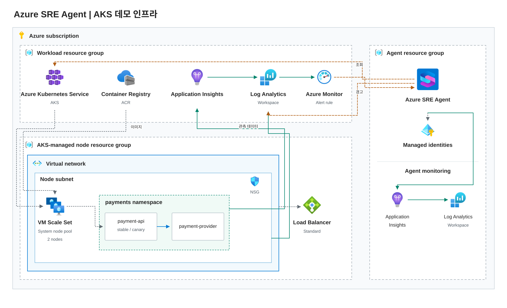

# SRE Agent Demo 진행 가이드

30분 고객 시연용입니다. 인프라는 미리 준비된 azd를 사용자가 직접 실행하고, SRE Agent는 사용자가 포털과 채팅에서 직접 구성합니다. 이 문서는 설정 위치·입력값·붙여 넣을 내용을 제공합니다.

저장소 루트는 `SRE-Agent-Demo/Azure-SRE-Agent-Demo-Sample`입니다. `<ENV_NAME>`은 사용자가 선택한 azd 환경 이름으로 바꿉니다.

## A. 준비 범위

| 번호 | 항목 | 준비 방식 | 제공할 내용 |
|---|---|---|---|
| 1 | 구독·리전·환경 이름 | 사용자 선택 | azd 파라미터·필수 권한 |
| 2 | 업무용 Resource Group | azd | 이름·태그·위치 |
| 3 | AKS·노드·자동 생성 네트워크 | azd | 노드 수·VM 크기·Entra/RBAC·통신 경로 |
| 4 | ACR·이미지 pull 권한 | azd | 레지스트리·관리 ID 권한 |
| 5 | 업무용 LAW·Application Insights | azd | 관측 원본·보존·앱 연결 |
| 6 | 컨테이너 로그·Kubernetes audit | azd | DCR·연결·진단 설정 |
| 7 | Azure Monitor 경고 규칙 | azd 제안 | 504 쿼리·Sev2·평가·해제 조건 |
| 8 | 앱 이미지 빌드·AKS 배포 | 확인 필요 | azd hook 또는 별도 명령 |
| 9 | SRE Agent 리소스 생성 | 확인 필요 | azd 포함 또는 포털 직접 생성 |
| 10 | Agent 관리 ID·필수 IAM 역할 | 확인 필요 | azd 또는 직접 역할 할당·자동 상속 확인 |
| 11 | Agent 리소스·로그 연결 | 포털 직접 | RG·LAW·App Insights·Reader·신원 |
| 12 | GitHub Code Access | 포털 직접 | Owner·Repository·Branch·URL·인증 |
| 13 | Team onboarding | 채팅 직접 | 구조 탐색·팀 맥락·정상 기준·지식 저장 질문 |
| 14 | Knowledge sources | 포털 직접 | 운영 맥락·런북 파일 |
| 15 | Skill | 포털 직접 | Name·Description·SKILL.md 본문 |
| 16 | 하위 응답 Agent | 포털 직접 | Name·Description·Instructions·도구 |
| 17 | 인시던트 플랫폼·Response Plan | 포털 직접 | Azure Monitor·사건 필터·담당·Review |
| 18 | 장애 주입·트래픽·복구 | 확인 필요 | 실습 제어 명령 또는 수동 Deployment 변경 |
| 19 | Operations Hub | 포털 직접 | 이번 사건·활동·대기 업무·원본 스레드 |
| 20 | Automation·Live Reports | 포털 직접 | 예약 입력값·점검 지침·보고서 작성 채팅 |

현재 azd 구현은 Agent 리소스 생성·읽기 권한과 앱 배포 hook까지 포함합니다. **8·9·10·18번의 구분을 확정한 뒤** 필요한 범위를 분리합니다. 그 전에는 인프라 파일의 자동화 범위를 임의로 바꾸지 않습니다.

## B. 아키텍처



업무용 RG에는 AKS·ACR·업무용 Application Insights·LAW가 있습니다. `payment-api`는 `payment-provider`를 호출하며 stable과 canary는 다른 이미지로 실행할 수 있습니다. Agent의 자체 실행 로그와 업무용 로그는 별개입니다.

현재 그림은 간단한 구성도입니다. 다음 디자인에서는 공식 Azure 서비스 아이콘, Resource Group 경계, AKS 내부 구성, 요청·관측·조사 경로를 구분합니다. 인프라 구성 범위가 확정되면 그림도 그 범위에 맞춥니다.

Microsoft 공식 [azure-resource-visualizer 스킬](https://github.com/microsoft/azure-skills/tree/main/skills/azure-resource-visualizer)은 리소스 관계를 분석해 **Mermaid 다이어그램**을 만듭니다. 확인한 설치 지표는 약 55만 회이며, Microsoft 소스 저장소는 약 1.6천 stars입니다. 발표용 디자인은 [공식 Azure 아이콘](https://learn.microsoft.com/en-us/azure/architecture/icons/)과 정보 배치를 별도로 다듬어야 합니다.

이 스킬을 설치하거나 실제 Azure 리소스 분석을 실행하지는 않았습니다.

## C. 30분 진행 순서

| 시간 | 단계 | 화면에서 확인할 내용 |
|---|---|---|
| 0–2분 | 아키텍처 | 이미 준비된 서비스·관측·코드·경고 구성 |
| 2–4분 | 리소스·로그 연결 | 업무용 RG와 LAW/App Insights 선택·조회 |
| 4–5분 | 코드 소스 연결 | GitHub 인증·저장소·배포 코드 대조 경로 |
| 5–8분 | 팀 온보딩 | 구조 탐색·담당 범위·정상 기준·생성 지식 |
| 8–10분 | 지식·Skill | 문서 등록·색인·조사 절차 입력 |
| 10–11분 | 인시던트 플랫폼 | Azure Monitor 접수·기본 계획 범위 |
| 11–14분 | Agent·Response Plan | 하위 Agent·필터·담당·Review·활성화 |
| 14–16분 | 이슈 설명·발생 | 증상 설명 뒤 실제 장애·요청 발생 |
| 16–22분 | 자동 조사 | 사건·계획·담당·실제 조회·로그·코드 근거 |
| 22–24분 | 결과 확인 | 원인·영향·근거·권고 조치·미확인 항목 |
| 24–26분 | Operations Hub | 방금 조사한 같은 사건의 현황·원본 스레드 |
| 26–28분 | Automation | 예약 조건·한 번 실행한 이력·결과 |
| 28–30분 | Live Reports | 저장된 보고서·조회 기준·Reload·갱신 시각 |

인수인계는 제외합니다. 온보딩 탐색·문서 색인·연결 재구성은 비동기이므로 시작한 뒤 다음 구성으로 이동하고 장애 발생 전에 완료를 확인합니다. Agent를 바꾼다면 서로 다른 사건·스레드임을 명시합니다.

## D. 인프라 준비

인프라에는 고객 앞에서 생성하지 않을 리소스를 준비합니다. 실제 실행은 사용자가 합니다.

| 입력 | 값 또는 기준 |
|---|---|
| Subscription | 사용자가 선택한 구독 |
| Environment name | 소문자로 시작하는 영문·숫자·하이픈 3~16자 |
| Region | 기본안 `eastus2`, 구독 제공 상태 확인 |
| Workload RG | `rg-<ENV_NAME>-workload` |
| AKS | `aks-<ENV_NAME>` |
| Node pool | 기본안 노드 2개·`Standard_D4s_v6` |
| ACR | 전역 고유 이름, admin/anonymous pull 비활성 |
| Workload LAW | `law-aks-<ENV_NAME>` |
| Workload App Insights | `appi-aks-<ENV_NAME>` |
| Payment alert | `payment-api-errors-aks-<ENV_NAME>` |
| Agent 모드 | 기본안 `Review`, 업무용 Writer는 부여하지 않음 |

경고 규칙은 payment-api의 504가 5분 창에서 2건을 초과하면 Sev2로 발화하고 1분 주기로 평가합니다. 경고 쿼리는 [workload.bicep](../infra/workload.bicep)에 있습니다. 구독 범위 Monitoring Contributor는 사건 스캔용 권한이므로 포함 여부와 대상 신원을 명확히 정합니다.

현재 [azure.yaml](../azure.yaml)의 postprovision hook은 이미지 빌드·앱 배포까지 수행합니다. 8·9·10번 확인 전에는 이를 순수 인프라 전용 템플릿이라고 소개하지 않습니다. 과금·권한·배포 대상은 실제 실행 전에 확인합니다.

## E. SRE Agent 직접 구성

포털 버전·언어에 따라 메뉴 표시가 다를 수 있습니다. 아래는 넣을 값과 구성 목적이며, 실행 스크립트를 대신 입력하는 절차가 아닙니다.

### Azure 리소스 연결

SRE Agent의 리소스 연결 화면에서 업무용 RG를 추가합니다.

| 항목 | 입력값 |
|---|---|
| Resource group | `rg-<ENV_NAME>-workload` |
| Permission level | `Reader` |
| 기본 실행 모드 | `Review` |

실제 관리 ID·자동 할당·상속 역할을 확인합니다. Azure 리소스 읽기와 Kubernetes 객체·로그 읽기는 함께 실제 조회로 시험합니다.

### 로그 원본 연결

로그 연결 화면에서 업무용 원본을 선택합니다.

| 항목 | 입력값 |
|---|---|
| Log Analytics Workspace | `law-aks-<ENV_NAME>` |
| Application Insights | `appi-aks-<ENV_NAME>` |
| Authentication | 해당 원본의 읽기 권한을 가진 Agent 관리 ID |

Agent 자체 로그용 LAW/App Insights와 구분합니다. Connected 표시뿐 아니라 원본의 실제 요청·로그 조회를 확인합니다.

### GitHub Code Access

**Builder → Code Access → GitHub**에서 인증과 저장소 선택을 완료합니다.

| 항목 | 입력값 |
|---|---|
| Owner | `Kimcheolhui` |
| Repository | `Azure-SRE-Agent-Demo-Sample` |
| Branch | `main` |
| URL | `https://github.com/Kimcheolhui/Azure-SRE-Agent-Demo-Sample` |

소스는 원격 저장소에 게시되어 있습니다. 실제 배포 `/version`의 SHA·이미지 digest와 릴리스별 빌드 입력을 대조합니다. v1.8은 [app/src/provider-client.mjs](../app/src/provider-client.mjs), v1.9는 [app/releases/v1.9/provider-client.mjs](../app/releases/v1.9/provider-client.mjs)를 같은 컨테이너 경로로 복사합니다.

### Team onboarding

Team onboarding 대화에서 순서대로 입력합니다. 구조 탐색 결과와 사용자가 알려 준 설명은 출처를 구분합니다.

**구조 탐색**

```text
우리 Payments 팀의 서비스 온보딩을 진행해 주세요. 연결된 Azure 리소스와 GitHub 저장소에서 서비스 구조·호출 관계·배포 구성을 탐색하고, 확인한 사실과 추가로 필요한 정보를 구분해 주세요. 이 단계에서는 리소스를 변경하지 마세요.
```

**팀 맥락**

```text
Payments demo 팀은 payments namespace의 payment-api와 payment-provider를 담당합니다. API는 카드와 계좌 결제 요청을 받아 provider의 승인 API를 호출합니다. provider는 실습용 서명 계산 서비스이며 실제 은행·고객 데이터·주문 DB는 없습니다. 이 환경은 고객 데모용이며 운영 환경과 분리되어 있습니다.
```

**정상 기준**

```text
정상 기준은 카드와 계좌 각각 새 요청 20건에서 실패 0건, p95 1,000ms 이하입니다. provider 호출의 기본 제한은 3초입니다. 일부 카드 요청의 서명 계산량이 크면 제한을 넘을 수 있지만, 해당 요청의 실패가 동시에 실행 중인 다른 요청이나 이후 요청으로 전파되면 안 됩니다. Pod Ready나 /health 성공만으로 결제 정상이라고 판단하지 마세요.
```

**지식 저장**

```text
지금까지 확인한 서비스 구조·담당 범위·정상 기준·조사 주의사항을 팀 지식으로 정리해 주세요. 저장한 파일과 출처를 알려 주고, 코드·리소스에서 직접 확인한 내용과 내가 제공한 설명을 구분해 주세요.
```

**새 대화에서 확인**

```text
Payments 서비스는 어떤 구성요소를 거치며, 어떤 조건을 만족해야 정상이라고 판단하나요? 팀 지식의 출처를 함께 알려 주세요. 실제로 확인하지 못한 내용은 추정하지 마세요.
```

### Knowledge sources

**Builder → Knowledge sources → File 추가**에서 실제 문서를 업로드합니다.

- [service-context.md](../agent/knowledge/service-context.md): 서비스 구조·정상 기준·담당 범위.
- [runbook.md](../agent/knowledge/runbook.md): 조사·변경 통제·복구 확인 절차.

업로드와 색인 완료·검색 성공을 구분합니다. 지식에 예상 원인을 미리 넣지 않습니다.

### 조사 Skill

| 항목 | 입력값 |
|---|---|
| Name | `payment-investigation` |
| Description | `Investigate payment errors, latency or instance-specific failures by correlating requests, dependencies, logs and deployed source.` |
| SKILL.md | 아래 본문 |

```markdown
# Payment Investigation

1. Confirm the actual resource group, AKS cluster, namespace and UTC investigation window.
2. Compare failure rate and p95 for card/bank, instance and deployed release. Separate process health from payment success.
3. Correlate request IDs, trace IDs, exceptions, dependency duration and container logs within the same time window.
4. Verify the Deployment image, Pod imageID and source revision. Read the matching provider-call implementation, not just repository HEAD.
5. Compare at least two plausible explanations using supporting and contradicting evidence. Trace object lifetime, request timing and network/CPU behavior where evidence warrants it.
6. Identify unavailable data and failed queries explicitly. Do not interpret an empty result as a healthy service.
7. Report root cause or remaining hypotheses, impact, query/source references, minimal mitigation and recovery conditions.
8. Do not change resources, retrieve secrets or retry payments during investigation.
9. Recovery requires fresh card/bank requests with zero failures and p95 <= 1,000 ms over 20 paired rounds, plus concurrent-request isolation when investigating timeout propagation.
```

원본은 [SKILL.md](../agent/skills/payment-investigation/SKILL.md)입니다.

### 하위 응답 Agent

**Builder → Agent Canvas → Create → Custom Agent**에서 입력합니다.

| 항목 | 입력값 |
|---|---|
| Name | `payment-specialist` |
| Handoff description | `Investigate payment service request failures, latency and deployment-related incidents using observed evidence.` |
| Tools | 기본 상속 유지. 빈 목록으로 override하지 않으며 실제 읽기 도구를 확인 |
| Instructions | 아래 지침 |

```text
결제 서비스의 장애 조사를 담당합니다. 연결된 운영 문서와 관련 Skill을 확인하고 사건의 대상·UTC 시간·고객 증상을 고정하세요. 요청한 시간 범위를 유지하며 도구의 기본 lookback이 더 길면 쿼리에 시간 조건을 추가하세요. 요청과 종속성·예외·컨테이너 로그를 같은 요청과 인스턴스로 연결하고 실제 배포 이미지와 소스 버전을 대조하세요. 여러 원인 후보의 지지·반대 근거와 조회하지 못한 원본을 구분하세요. 원인·영향 범위·실행한 쿼리·코드 위치·권고 조치·검증 조건을 한국어로 설명하세요. 운영 문서와 실제 관측이 다르면 실제 결과를 우선하고 차이를 명시하세요. 리소스·코드·설정을 변경하거나 거래를 재시도하지 마세요. 비밀·토큰·Secret 내용은 조회하거나 출력하지 마세요.
```

### 인시던트 플랫폼

**Builder → Incident platform**에서 Azure Monitor를 선택하고 저장합니다. 사건 수집에 사용하는 신원과 구독 범위 권한을 확인합니다. 자동 생성된 포괄적 quickstart 계획은 Off로 유지합니다.

### Response Plan

**Incidents → Triggers + response plans**에서 계획을 만듭니다.

| 항목 | 입력값 |
|---|---|
| Name | `payment-alert-response` |
| Severity | `Sev2` |
| Title contains | `payment-api-errors-aks-<ENV_NAME>` |
| Response subagent | `payment-specialist` |
| Agent autonomy level | `Review` |
| Title does not contain | 별도 제외 조건이 없으면 빈칸 |
| 활성화 | Preview에서 해당 데모 경고만 선택되는지 확인한 뒤 On |

쿨다운과 반복 경고 병합은 별도 설정입니다. 반복 시연에서 새 사건과 조사 연결을 확인합니다.

## F. 장애 시연

8·18번의 실행 방식이 확정되기 전에는 사용자용 실행 명령을 고정하지 않습니다.

| 단계 | 수행 내용 |
|---|---|
| 기준선 | 정상 이미지에서 카드·계좌 각 20건의 성공·p95 확인 |
| 장애 설명 | 일부 인스턴스의 새 버전 적용 뒤 504가 발생한다는 증상만 설명 |
| 실제 발생 | v1.9 canary와 동시 요청 A·B·C 실행 |
| 접수 | 실제 경고·Response Plan·담당·조사 스레드 확인 |
| 조사 관찰 | 요청·인스턴스·취소 로그·배포 코드의 근거 연결 |
| 결과 확인 | 원인·영향·권고 조치·미확인 항목 대조 |
| 복구 | 정상 이미지와 새 요청, 타임아웃 격리 확인 |
| 다음 시연 | 이전 경고 해제와 새 UTC 구간 확인 |

대화형 질문을 보충할 때는 다음 내용을 사용합니다.

```text
rg-<ENV_NAME>-workload의 aks-<ENV_NAME>, payments namespace에서 새 버전 적용 후 일부 인스턴스의 결제 요청이 504로 실패한다는 보고가 있습니다. 최근 30분의 원인과 영향 범위를 조사해 주세요. 관련 지식과 Skill을 활용하고 실제 요청·로그·배포 코드 근거를 연결하세요. 리소스를 변경하거나 결제를 재시도하지 마세요.
```

Agent의 입력에는 정답·변경 변수·복구 명령을 넣지 않습니다. 대화형 요청과 자동 사건 접수를 혼동하지 않습니다.

## G. 운영 기능 직접 구성

### Operations Hub

방금 조사한 같은 Agent에서 사건·활동·승인 대기·원본 스레드를 확인합니다. 같은 서비스라도 다른 Agent의 별도 조사와 혼동하지 않습니다.

### Automation

예약 작업 생성 화면에서 다음 값을 입력합니다.

| 항목 | 입력값 |
|---|---|
| Name | `payment-daily-health` |
| Agent | `payment-specialist` |
| Schedule | `Custom cron` |
| Cron expression | `0 0 * * *` |
| Time zone | UTC 00:00 / KST 09:00 |
| Autonomy level | `Review` |
| 정기 실행 | 실습 전후 Paused, 수동 실행 결과 확인 후 다시 중지 |
| Agent prompt | 아래 내용 |

```text
rg-<ENV_NAME>-workload의 aks-<ENV_NAME>, payments namespace를 대상으로 최근 30분의 결제 요청·결제 수단별 실패율·p95·인스턴스별 오류·Deployment 상태를 읽기 전용으로 점검해 주세요. 팀의 정상 기준과 비교하고 미조회 항목은 명시하세요. 리소스를 변경하지 마세요.
```

Run now 접수·실행 이력·실제 결과 스레드를 구분합니다. 성공 집계만 보지 말고 최종 점검 결과의 대상·시간·원본을 확인합니다.

### Live Reports

**Live Reports → New report**의 작성 대화에서 입력합니다.

```text
Payments Service Live Report를 만들어 주세요. 연결된 업무용 Log Analytics/Application Insights에서 최근 30분의 payment-api 데이터를 조회해 결제 수단별 요청 수·실패율·p95, release와 인스턴스별 오류, 분당 504 추이를 보여 주세요. 조회 대상 리소스와 UTC 구간·갱신 시각을 표시하고, 정상 기준인 실패 0건과 p95 1,000ms 이하와 비교해 주세요. 데이터가 없으면 0이나 정상으로 표시하지 말고 미확인으로 표시하세요. 리소스를 변경하는 액션은 넣지 마세요.
```

저장·갤러리·구성 버전·Reload를 확인합니다. 실제 쿼리와 화면의 시간 범위·단위·지표를 대조합니다. 다운로드 HTML은 정적 사본입니다.

참고 쿼리: [결제 집계](../queries/payments.kql), [오류 추이](../queries/trend.kql), [요청·종속성](../queries/correlation.kql), [컨테이너 로그](../queries/container-logs.kql).

## H. 사전 확인

- 사용자가 실행할 azd 범위와 직접 만들 Agent·권한의 구분.
- 실제 배포 버전·로그·GitHub 코드 접근.
- 온보딩 지식 저장·새 대화 조회·문서 색인·Skill 사용.
- 실제 경고·계획·담당·현재 실행의 자동 조사.
- 같은 사건의 Operations Hub와 예약 실행·보고서 재조회.
- 실습 전후 정상 복구와 반복 작업 중지.

기존 API 설정 스크립트는 내부 회귀 검증용 도구로 남아 있으며 이 가이드의 사용자 구성 절차에 사용하지 않습니다. Azure 배포·Agent 설정·권한 변경을 제가 대신 실행하지 않습니다.

[리허설 검증 결과와 제약](verification.md)